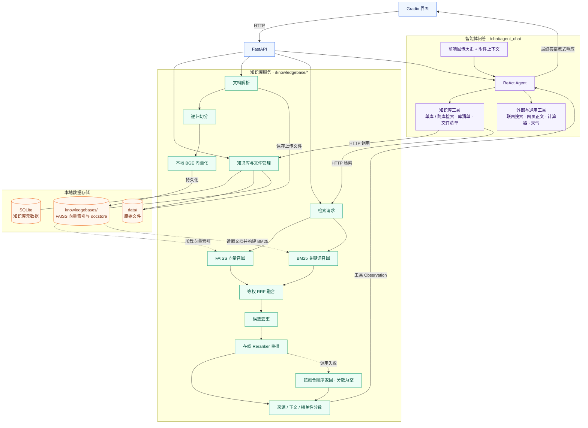

# 私有知识库问答与 Agent 系统（RAG + ReAct）

面向本地文档的问答与工具调用原型。用户在 Gradio 界面创建知识库、上传资料并提问，Agent 可选择单库或跨库检索，也可调用联网搜索、网页正文抓取、计算器和天气工具。

## 主要功能

- **知识库管理**：创建、查看、删除知识库；批量上传 PDF、TXT、Markdown、CSV；查看文件列表，删除文件时同步清理对应向量。
- **文档问答**：本地 BGE 向量检索与中文 BM25 混合召回，调用在线 Reranker 重排；检索接口返回来源、正文和相关性分数。
- **Agent 对话**：注册 8 个工具，按 ReAct 格式循环调用；提示词引导优先查询本地知识库，再考虑联网搜索。
- **聊天交互**：支持多轮历史、系统提示词与采样参数调整、最终答案流式显示。可随对话附加 TXT/MD/PY/CSV/JSON/PDF/DOCX，附件仅作为当次上下文，不自动入库。

知识库上传与聊天附件是两条独立链路。图片、音视频、压缩包不支持正文解析；PDF 仅提取已有文本，不含 OCR。

## 技术架构

Python · FastAPI · Gradio · LangChain Classic · FAISS · BM25/jieba · BGE · SQLAlchemy/SQLite。



### 检索与存储细节

- `knowledgebase_server/loader/loader.py`：PDF 使用 PyPDFLoader，TXT/MD 使用 UTF-8 TextLoader，CSV 使用 CSVLoader。
- `RecursiveCharacterTextSplitter` 默认分块长度 128、重叠 20，可在上传时调整；应保证 `0 <= chunk_overlap < chunk_size`。
- FAISS 与 BM25 默认**各召回 10 条**，`EnsembleRetriever` 按 0.5/0.5 加权 RRF 融合，融合后候选可能多于 10 条；BM25 在每次检索时从 docstore 构建。
- 硅基流动 Rerank API 默认使用 `BAAI/bge-reranker-v2-m3`，每段送出前最多取 2000 字符，默认保留前 3 条。失败时返回融合顺序前 3 条，分数为 `null`。
- 跨库工具顺序遍历各库，将各库返回片段按重排分数排序、去重，默认返回 5 条；没有进行全局二次重排。
- SQLite 只有 `knowledge_bases` 表（`id`、`kb_name`、`kb_info`），文件由目录管理，片段来源保存在 FAISS docstore 的 metadata 中。
- 删除文件先清理并保存索引，成功后再删除原文件；这不是跨数据库与文件系统的事务。
- Agent 用 `create_react_agent` 与 `AgentExecutor` 编排；工具 Observation 回填到 scratchpad。自定义异步回调识别 `Final Answer:` 后转发 token，整体设有超时。

## 目录

```text
app_server.py                FastAPI 入口（127.0.0.1:6605）
webui.py                     Gradio 双标签界面
chat/                        请求模型、历史组装、Agent 与流式响应
configs/                     环境变量读取与 ReAct 提示词
knowledgebase_server/        知识库接口、文件解析、混合检索和重排
db_server/                   SQLAlchemy 模型与元数据操作
tools/                       8 个注册工具及其实现
utils/                       附件文本提取、异步回调、模型下载脚本
webui/                       前端 HTTP 调用封装
tests/test_load_docs.py       可移植的附件解析检查
test1.py                     现有知识库检索冒烟脚本
test_rerank.py               检索结果人工检查脚本
requirements.txt             直接依赖清单
.env.example                 无密钥的配置模板
```

运行生成的 `data/`、`knowledgebases/`、SQLite 数据库、模型和虚拟环境均不随仓库分发。原工作区的个人笔记与旧架构草稿也不纳入公开仓库。

## 本地运行

以下命令在 Linux / WSL 的项目根目录执行。当前本地检查环境为 Python 3.14.4；代码使用 `asyncio.timeout`，要求 Python 3.11+，其他 Python 版本尚未验证。依赖清单未锁版本，安装后的兼容性需自行验证。

### 1. 安装依赖

```bash
python3 -m venv .venv
source .venv/bin/activate
python -m pip install -r requirements.txt
mkdir -p db_server/data
cp .env.example .env
```

编辑 `.env`，填入自己的配置。进程环境变量优先于 `.env`，其次使用源码默认值。

### 2. 准备 Embedding 模型

默认路径为项目下 `model/bge-large-zh-v1__5`，可将完整模型目录放在此处，或通过 `EMBEDDING_MODEL_PATH` 指定路径。例如：

```bash
python -c "from modelscope.hub.snapshot_download import snapshot_download; snapshot_download('AI-ModelScope/bge-large-zh-v1.5', local_dir='model/bge-large-zh-v1__5')"
```

仓库原有 `utils/downloader.py` 使用 `cache_dir='models'`，与配置默认 `model/` 不同；若使用该脚本，需把实际下载后的完整模型路径填入 `EMBEDDING_MODEL_PATH`。模型在后端导入时加载，缺失会导致启动失败。

### 3. 必要配置

| 变量 | 用途与默认行为 |
| --- | --- |
| `DEEPSEEK_API_KEY` | 对话生成必需，使用自己的服务密钥 |
| `DEEPSEEK_BASE_URL`、`CHAT_MODEL_NAME` | OpenAI 兼容生成接口；按账户实际可用模型填写，模板值不代表已验证可用 |
| `SILICONFLOW_API_KEY` | 在线重排；未配置或调用失败会走检索降级 |
| `RERANK_BASE_URL`、`RERANK_MODEL_NAME` | 重排地址与模型，见模板 |
| `SERPAPI_KEY` | 联网搜索（百度引擎）；未配置时工具返回提示 |
| `WEATHER_API_KEY` | 心知天气；未配置时工具返回提示 |
| `EMBEDDING_MODEL_PATH` | 可选，本地完整 Embedding 模型目录 |
| `SEARCH_CANDIDATE_K`、`RERANK_TOP_N` | 默认每路召回 10 条、重排保留 3 条 |
| `RERANK_MAX_DOC_CHARS`、`TIME_OUT` | 默认 2000 字符、60 秒 |

其他变量：`MULTI_KB_TOP_N`（5）、`ATTACHMENT_MAX_CHARS`（20000）、`FETCH_URL_MAX_CHARS`（4000）。`KB_API_BASE` 可覆盖知识库工具地址，`CHAT_API_URL` 可覆盖聊天前端地址；知识库管理前端仍固定访问 `http://127.0.0.1:6605`。部分模块直接读进程变量，建议在启动前通过 `export` 设置这些可选变量。

### 4. 启动与使用

在两个终端中分别激活同一环境，并保持当前目录为项目根目录：

```bash
# 终端 1
python app_server.py
# 终端 2
python webui.py
```

打开 Gradio 控制台打印的本地地址（通常为 `http://127.0.0.1:7860`）。后端接口文档为 `http://127.0.0.1:6605/docs`。

1. 在「知识库管理」创建库，选择该库并上传受支持的文件。
2. 在「聊天机器人」提问，可在问题中指定库名，也可让 Agent 跨库检索。
3. 在管理页查看或删除文件，必要时删除整个知识库。

## 接口

| 方法 | 路径 | 输入 |
| --- | --- | --- |
| POST | `/chat/agent_chat` | JSON：`query`，可选 `history`、`documents`、`history_len` 和采样参数；响应为纯文本流 |
| POST | `/knowledgebase/create_kb` | JSON：`kb_name`、`kb_info` |
| GET | `/knowledgebase/list_kbs` | 无 |
| GET | `/knowledgebase/list_files` | 查询参数 `kb_name` |
| DELETE | `/knowledgebase/delete_kb` | 查询参数 `kb_name` |
| DELETE | `/knowledgebase/delete_file` | 查询参数 `kb_name`、`file_name` |
| POST | `/knowledgebase/upload_docs` | multipart：`files`、`kb_name`、`chunk_size`、`chunk_overlap` |
| POST | `/knowledgebase/search_kb` | JSON：`kb_name`、`query`；返回 `results`，每项含 `source`、`page_contents`、`relevance_score` |

## 验证

```bash
python -m pip check
python tests/test_load_docs.py
# 以下需要本地模型及已经上传资料的知识库；会尝试调用在线重排
python test1.py 示例知识库 "资料主要讲了什么？"
python test_rerank.py 示例知识库 "资料主要讲了什么？" --raw
```

附件检查覆盖正常文本、PDF/DOCX、损坏文件、未知格式、空文件与截断。后两个脚本用于检查检索链路与人工查看结果，不构成量化检索质量评测；返回结果也不代表在线重排一定成功，应检查分数是否为 `null`。

## 当前边界

- 面向本地单用户演示，尚无登录鉴权、租户隔离与生产部署配置。库名及上传路径等校验不完整，不应直接暴露到公网。
- 文档本地保存，但生成、重排、搜索等使用外部服务；问题、召回片段或附件内容可能发送给相应服务。
- 多轮历史由前端回传并截取最近轮次；`session_id` 未用于服务端会话持久化。
- 同名文件重复上传可能覆盖原文件并追加重复向量，未实现去重、版本管理或增量索引。
- 数据库、文件与索引未做原子事务；全局数据库会话、同步工具与模型调用未做并发优化。
- 最终答案流依赖模型遵循 ReAct 格式及回调的 token 前缀识别；检索提供来源，但未强制最终回答生成引用编号。
- 未建立标准评测集，不提供准确率、召回率提升或性能承诺。
